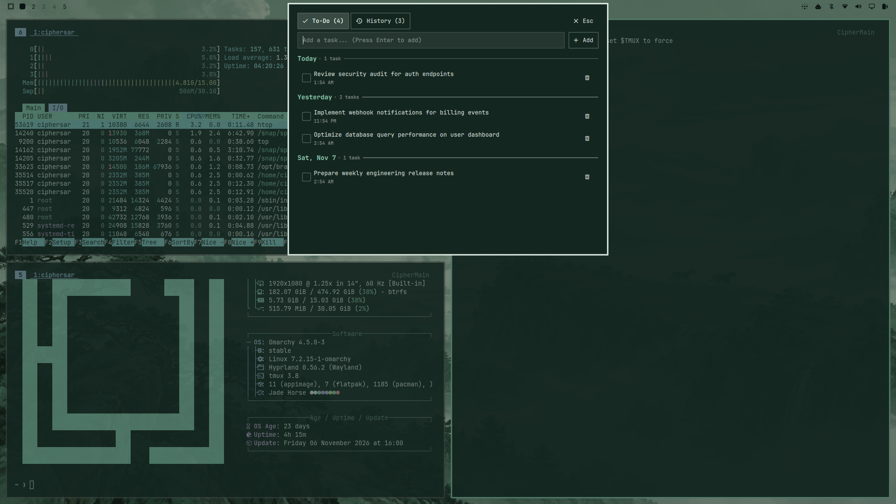
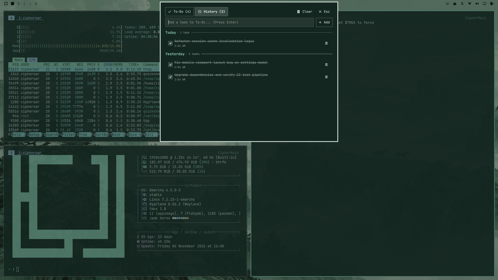

# Omarchy To-Do List Plugin

A beautiful, theme-aware, Quake-style drop-down To-Do list plugin for [Omarchy](https://omarchy.org/) Linux and Hyprland.

### To-Do Tab


### History Tab


## Features

- **Quake-Style Drop-Down Console**: Drops down smoothly from the top of the screen on invocation and slides back up when dismissed.
- **Two Tabs**:
  - **To-Do**: Active tasks, organized by date with interactive checkboxes.
  - **History**: Completed activities with completion timestamps, clear history option, and option to restore tasks.
- **Top Input Bar**:
  - Typing space at the very top with autofocus when opened.
  - **Add Button** to the right of the typing space (and `Enter` key shortcut).
- **Date-Organized Activity List**:
  - Automatically groups tasks by date (*Today*, *Yesterday*, formatted weekdays and dates) with task counters.
  - Chronological / reverse-chronological sorting.
- **Task Controls**:
  - **Checkbox** on the left of each activity: checking in To-Do marks it complete and moves it to History; unchecking in History restores it to To-Do.
  - **Delete Button (Bin Icon)** on the right of each activity: permanently removes the task.
- **Theme Matching**:
  - Automatically matches Omarchy themes live (accent colors, surfaces, borders, font scaling, and rounded/sharp corner radii).
- **Keyboard-First & Fast**:
  - `Escape` or clicking outside dismisses the console.
  - `Ctrl+1` / `Ctrl+2` to switch between To-Do and History tabs.
  - Global hotkey: `SUPER + ALT + T` (configurable).
- **CLI Utility**:
  - Companion `omarchy-todo` command-line script for quick terminal interactions and task scripting.

---

## Installation

### Method 1: Using `omarchy plugin`

```bash
omarchy plugin add <repo-url> --enable --yes
```

### Method 2: Manual Installation

Clone into your Omarchy user plugins folder:

```bash
git clone <repo-url> ~/.config/omarchy/plugins/ciphersar.todo
omarchy-shell shell rescanPlugins
omarchy plugin enable ciphersar.todo
```

### Install CLI Helper

```bash
mkdir -p ~/.local/bin
cp bin/omarchy-todo ~/.local/bin/omarchy-todo
chmod +x ~/.local/bin/omarchy-todo
```

---

## Usage

### Drop Down Console

- **Global Keybinding**: Press `SUPER + ALT + T`
- **Via CLI**:
  ```bash
  omarchy-todo          # Toggle console
  omarchy-todo open     # Open console
  omarchy-todo history  # Open directly to History tab
  omarchy-todo close    # Dismiss console
  ```
- **Via Omarchy Shell IPC**:
  ```bash
  omarchy-shell shell toggle ciphersar.todo
  omarchy-shell shell summon ciphersar.todo '{"tab":"history"}'
  omarchy-shell shell hide ciphersar.todo
  ```

### CLI Quick Commands

Add and list tasks directly from your shell or terminal scripts:

```bash
omarchy-todo add "Review pull request #42"
omarchy-todo list
```

---

## Keybindings

| Keybinding | Action |
|---|---|
| `SUPER + ALT + T` | Toggle drop-down To-Do console |
| `Enter` (in input field) | Add task to list |
| `Ctrl + 1` / `Alt + 1` | Switch to To-Do tab |
| `Ctrl + 2` / `Alt + 2` | Switch to History tab |
| `Escape` | Dismiss drop-down console |

To customize your hotkey, edit `~/.config/hypr/bindings.lua`:
```lua
o.bind("SUPER + ALT + T", "To-Do list", "omarchy-todo")
```

---

## Data Storage

Tasks and completion history are stored in clean JSON format at:
```
~/.local/state/omarchy/todo-items.json
```
Atomic writes ensure data safety across system reboots and shell reloads.

---

## License

MIT License. See [LICENSE](LICENSE) for details.
